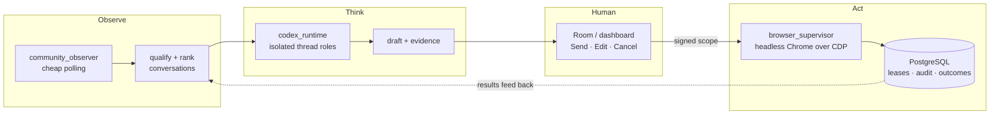

<div align="center">

# Wenext

**An agent that finds the conversations where your product is the answer, drafts the reply, and waits for your click.**


<sub>Demo organisation with seeded data (product "tallymark", fictional accounts). The "Posted" step is staged by the demo script; nothing is published.</sub>

</div>

---

## What it does

Wenext watches the communities your customers already use (Reddit is being validated now; X appears in the demo data). When someone describes a problem your product solves, the agent:

1. **Finds the thread and qualifies it:** is this a real need, is it fresh, is a reply welcome there?
2. **Builds context:** it reads your repo (read-only) and works out who needs the product and what pain it removes, so the draft says something specific instead of "check out our tool".
3. **Drafts the reply** in your voice: helpful first, the product only where it truly answers, with disclosure. The draft lands in your Room with the reason the thread matters.
4. **Posts nothing without your click.** One click on **Send** signs a narrow scope (which accounts, how many posts per hour and per day, until when). The browser session posts the reply, and the card turns into **Posted**.

The long-term product direction is a workspace in which you describe a goal and the agent runs a project between sessions within a signed scope. That part is still being validated (see [Status](#status)).

## How it works



| Part | What it is |
| --- | --- |
| `services/community_observer` | Low-cost continuous observation; the model is only woken up for work that needs judgement. |
| `services/codex_runtime` | Adapter for Codex as the reasoning engine, with separate, isolated thread roles. |
| `services/browser_supervisor` | Headless Chrome driven over CDP; a logged-in profile is the execution layer. |
| `services/profile_lease` | One writer per browser profile, enforced with a lease and a fencing token in PostgreSQL. |
| `services/stream_gateway` | RFB-aware proxy for the noVNC view; `VIEW_ONLY` is enforced on the server, not in the UI. |
| `services/control_plane`, `db/` | API, auth boundary and 41 SQL migrations. |
| `apps/dashboard` | Next.js operator dashboard. Control-plane calls go through Next.js server code, so the browser never talks to the control plane directly. |
| `plugins/wenext` | Plugin for Codex and Claude Code: say "find my first users" in the folder of what you built. One MCP server and seven skills; the agent itself cannot publish. |
| `evals/` | Fixture conversations, scoring and memory A/B runs for planning and marketing research. |

### Engineering choices worth a look

- **Login is a human step.** Login, MFA and challenges move the profile into an interactive noVNC session; the agent resumes headless on the same profile without logging in again. A challenge or a lost session stops the account in a controlled way (`MANUAL_ONLY`) and creates a task for a human.
- **Gates that cannot pass by accident.** The go/no-go report generator returns `NIE_URUCHOMIONO` (not run) when evidence is missing, never `GO`, and it refuses to pass a gate that has no required check defined.
- **Thresholds written down before measuring.** Changing a gate threshold creates a new plan version and invalidates the current result.
- **Docs that are checked against the code.** `make check-docs` and `make check-versions` fail the build when the documentation or the Dockerfiles drift from `versions.lock.toml`.
- **Sandboxed browser.** The capsule runs as non-root, its CDP port is reachable only from inside the container, and it has no route to the open internet in the test profile.

## Quick start

Requirements: Docker (native, not emulated), `uv`, Node 24.

```bash
make doctor          # is this host fit to run the stack?
make up              # db + capsule + gateway + fixture site, waits for healthy
make test-all        # every suite that runs on the host
```

Demo with seeded data (the GIF above):

```bash
make demo-seed       # demo organisation: tallymark, 4 conversations, 4 drafts
make dashboard       # operator dashboard on 127.0.0.1:3000
make demo-watch      # second terminal: stages the queued send as "Posted" after ~3 s (no real post)
```

`make help` lists every target. Running against a real Codex account needs your own ChatGPT login, as set up with `make codex-gonogo`.

## Status

**Pre-release, built by its founders.** Stages P0–P7 are built and tested on a local stack, mostly against fixtures rather than live platforms. What has not been proven yet is a full day of unattended work with a real model, and whether the replies are good enough. That is being measured on one Reddit project right now. The service runs on the author's machine; a server deployment package exists, but no server has been chosen.

Earlier go/no-go gates (headless CDP contract, headful ↔ headless handoff without losing the session, Codex running unattended for a 3-hour window) all returned GO. The third one has four documented caveats, among them 3 h instead of the planned 6 h,.

Automating logged-in accounts conflicts with the terms of some platforms. The founders know this and accept the risk; this repository does not claim otherwise.

## Docs

Engineering docs are in Polish.

- [docs/adr/](docs/adr/): architecture decisions
- [docs/threat-model/](docs/threat-model/): threat model and the controls it is tested against
- [docs/f0-limits/](docs/f0-limits/): scope that was deferred on purpose, with the stage it belongs to
- [docs/WDROZENIE-SERWER.md](docs/WDROZENIE-SERWER.md): server deployment
- [ROADMAP_CODEX_CDP_COMMUNITY_OS.md](ROADMAP_CODEX_CDP_COMMUNITY_OS.md): the original product and architecture plan (several conformance tests read it)

## Stack

Python (uv) · PostgreSQL · Next.js 16 / React 19 · headless Chrome + CDP · noVNC · Docker Compose · Cloudflare Workers (MCP edge) · Codex · Claude Code plugin

## License

MIT, see [LICENSE](LICENSE).
